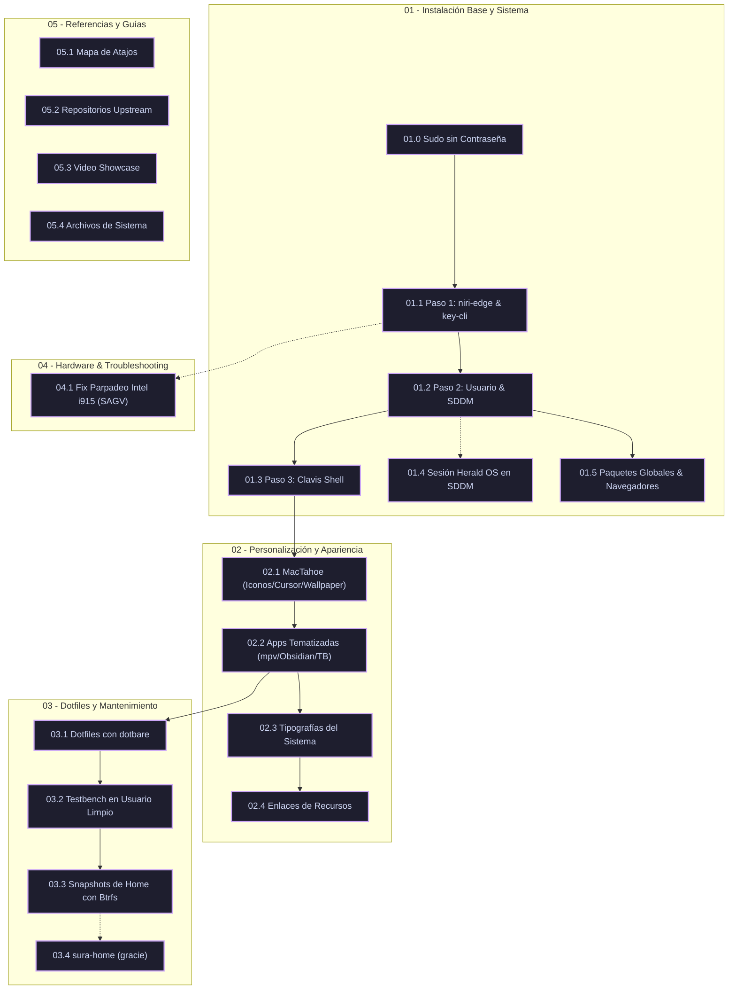

# 🌌 Niri Desktop + Clavis Shell — Playbook Genérico (MOC)

> [!NOTE]
> **Bienvenido a tu Vault de Obsidian:**
> Este repositorio constituye un **playbook modular, genérico y funcional** para construir, personalizar y mantener un entorno de escritorio completo basado en **`niri-edge`** (Wayland scrollable tiling compositor) y **`Clavis Shell`** (suite de interfaz basada en Quickshell y C++ con estética macOS / Liquid Glass).

---

## 🎬 Demostración del Entorno (Showcase)

![[assets/niri_showcase_unixporn_720p.mp4]]

*(Consulta la demostración en 1080p y la guía de streaming en [[05.3 - Guia de Descarga e Integracion de Video (Showcase)|Video Showcase y Guía de Descarga]])*

---

## 🗺️ Mapa de Ruta del Playbook



---

## 🗂️ Estructura Completa del Vault

```text
niri-omarchy-playbooks/
├── 00 - Indice General (MOC).md                       # 🗺️ Mapa de Contenidos interactivo con Mermaid
├── README.md                                          # 📖 Guía de bienvenida para Obsidian y GitHub
├── AGENTS.md                                          # 🤖 Reglas para agentes (git, forks, StatIndet)
├── 01 - Instalacion Base y Sistema/                   # ⚙️ Módulo 1: Base, compilación y usuarios
│   ├── 01.0 - Sudo sin Contrasena (Passwordless Sudo).md
│   ├── 01.1 - Paso 1 - Instalacion de niri-edge y key-cli.md
│   ├── 01.2 - Paso 2 - Creacion de Usuario y Login SDDM.md
│   ├── 01.3 - Paso 3 - Clavis Shell y Actualizaciones.md
│   ├── 01.4 - Sesion Herald OS en SDDM.md
│   └── 01.5 - Paquetes Globales y Navegadores del Sistema.md
├── 02 - Personalizacion y Apariencia/                 # 🎨 Módulo 2: Temas, estilos y aplicaciones
│   ├── 02.1 - MacTahoe Iconos, Cursor y Wallpapers.md
│   ├── 02.2 - Replicacion de Aplicaciones y Entorno Clavis.md
│   ├── 02.3 - Tipografias y Fuentes del Sistema.md
│   ├── 02.4 - Referencias de Temas, Wallpapers y Recursos.md
│   └── 02.5 - Entorno Modular Nyxuri (Noctalia Shell).md
├── 03 - Gestion de Dotfiles y Mantenimiento/          # 📦 Módulo 3: Versionado, pruebas y snapshots
│   ├── 03.1 - Dotfiles con dotbare.md
│   ├── 03.2 - Validacion en Usuario Limpio (Testbench).md
│   ├── 03.3 - Snapshots de Home con Btrfs.md
│   └── 03.4 - Dotfiles de Omarchy para gracie (Planificado).md
├── 04 - Troubleshooting y Hardware/                   # 🔧 Módulo 4: Solución de problemas
│   └── 04.1 - Fix Parpadeo Intel i915 (FIFO Underrun & SAGV).md
├── 05 - Referencias y Atajos/                         # ⌨️ Módulo 5: Atajos, fuentes y multimedia
│   ├── 05.1 - Mapa Completo de Atajos de Teclado (Niri y Clavis).md
│   ├── 05.2 - Repositorios Upstream y Fuentes Externas.md
│   ├── 05.3 - Guia de Descarga e Integracion de Video (Showcase).md
│   └── 05.4 - Archivos de Sistema de Referencia.md
└── assets/                                            # 🎬 Videos integrados y archivos de sistema
    ├── system/                                        # Copias exactas de /etc y /usr/local (ver 05.4)
    ├── m2-res_1080p.mp4
    └── niri_showcase_unixporn_720p.mp4
```

---

## 📚 Índice de Contenidos

### 1️⃣ Instalación Base y Configuración del Sistema
Guías paso a paso para la preparación de dependencias, compilación nativa y cuentas de usuario:
- [[01.0 - Sudo sin Contrasena (Passwordless Sudo)|01.0 — Sudo sin Contraseña (Passwordless Sudo)]]: Concesión de privilegios persistentes y solución al caso borde de `sudo -v` / `verifypw`.
- [[01.1 - Paso 1 - Instalacion de niri-edge y key-cli|01.1 — Paso 1: Instalación de niri-edge y key-cli]]: Compilación a nivel de sistema del compositor con minimización y daemon CLI con telemetría de hardware.
- [[01.2 - Paso 2 - Creacion de Usuario y Login SDDM|01.2 — Paso 2: Creación de Usuario Dedicado y Login SDDM]]: Configuración del gestor de inicio SDDM con tema Catppuccin Mocha y selector interactivo.
- [[01.3 - Paso 3 - Clavis Shell y Actualizaciones|01.3 — Paso 3: Clavis Shell y Procedimiento de Actualizaciones]]: Suite QML/C++, módulos nativos, demonios de sesión y script de actualización diaria.
- [[01.4 - Sesion Herald OS en SDDM|01.4 — Sesión Herald OS en SDDM]]: Cómo SDDM reconoce la sesión de Herald OS y su convivencia con Niri + Clavis y Omarchy (sin pasos de instalación).
- [[01.5 - Paquetes Globales y Navegadores del Sistema|01.5 — Paquetes Globales y Navegadores del Sistema]]: Instalación de la suite transversal de herramientas y navegadores (`meld`, `git-delta`, `elio-bin`, Zen, Brave Origin, Edge, Chrome).

---

### 2️⃣ Personalización y Apariencia Visual
Integración de temas, recursos visuales, cursores y aplicaciones completas:
- [[02.1 - MacTahoe Iconos, Cursor y Wallpapers|02.1 — MacTahoe: Iconos, Cursor, Wallpaper y Temas GTK]]: Instalación global de la suite MacTahoe y wallpaper oficial Wallhaven 5y3571.
- [[02.2 - Replicacion de Aplicaciones y Entorno Clavis|02.2 — Replicación de Aplicaciones y Entorno Clavis]]: Configuración de mpv Cupertino, Obsidian Violet, Thunderbird LiquidBird, shells Fish y Zsh (prompt C++), SPlayer-Next, animaciones elásticas y colores dinámicos Matugen.
- [[02.3 - Tipografias y Fuentes del Sistema|02.3 — Tipografías y Fuentes del Sistema]]: Instalación y jerarquía de LXGW WenKai GB Screen, JetBrainsMono Nerd Font y Material Symbols.
- [[02.4 - Referencias de Temas, Wallpapers y Recursos|02.4 — Referencias de Temas, Wallpapers y Recursos]]: Enlaces y fuentes oficiales de los activos gráficos.
- [[02.5 - Entorno Modular Nyxuri (Noctalia Shell)|02.5 — Entorno Modular Nyxuri (Noctalia Shell)]]: Sistema desacoplado Niri + Noctalia Shell, display manager Greetd, actualización independiente y desinstalación limpia sin residuos.

---

### 3️⃣ Control de Versiones, Calidad y Mantenimiento
Control de estado, replicación de configuración y políticas de respaldo:
- [[03.1 - Dotfiles con dotbare|03.1 — Gestión de Dotfiles con dotbare]]: Control de versiones Git *bare* sobre `$HOME`, auditoría de secretos y script de post-instalación.
- [[03.2 - Validacion en Usuario Limpio (Testbench)|03.2 — Validación en Usuario Limpio (Testbench)]]: Metodología de control de calidad y lista de verificación visual (QA); testbench persistente `sura` para pruebas visuales sin tocar producción (`niri`).
- [[03.3 - Snapshots de Home con Btrfs|03.3 — Snapshots de /home con Btrfs]]: Instantáneas CoW locales, transferencias incrementales a discos externos y restauración granular.
- [[03.4 - Dotfiles de Omarchy para gracie (Planificado)|03.4 — Dotfiles de Omarchy para gracie (Planificado)]]: ✅ Hecho como `robert-flo/sura-home` (privado, dotbare); decisiones resueltas y uso diario.

---

### 4️⃣ Diagnóstico y Soporte de Hardware
- [[04.1 - Fix Parpadeo Intel i915 (FIFO Underrun & SAGV)|04.1 — Fix de Parpadeo en Gráficas Intel i915]]: Eliminación de pantallas negras breves desactivando SAGV en Early KMS y fijando modos de salida.

---

### 5️⃣ Referencias Rápidas y Recursos
- [[05.1 - Mapa Completo de Atajos de Teclado (Niri y Clavis)|05.1 — Mapa Completo de Atajos de Teclado]]: Hoja de referencia rápida de todos los atajos de Quickshell IPC, navegación y control de ventanas en Niri.
- [[05.2 - Repositorios Upstream y Fuentes Externas|05.2 — Repositorios Upstream y Fuentes Externas]]: Registro de commits, ramas y licencias de los componentes base.
- [[05.3 - Guia de Descarga e Integracion de Video (Showcase)|05.3 — Video Showcase y Guía de Descarga]]: Instrucciones técnicas de extracción de video con `yt-dlp` y DevTools.
- [[05.4 - Archivos de Sistema de Referencia|05.4 — Archivos de Sistema de Referencia]]: Copias exactas en `assets/system/` (sudoers, SDDM, actualizador y timer, i915) con instalación y comprobación.

---

## ⚙️ Guía de Parametrización Rápida

Todos los scripts de este vault son **genéricos e idempotentes**. Por defecto utilizan:
- **Usuario Objetivo:** `TARGET_USER="${TARGET_USER:-niri}"`
- **Directorio de Compilación:** `BUILD_DIR="${BUILD_DIR:-/opt/src}"` (propiedad del usuario administrador; el actualizador diario compila como ese usuario)
- **UID Dinámico:** `$(id -u "$TARGET_USER")`
- **Rutas de Usuario:** `$HOME` y `~` en lugar de rutas fijas.

> [!TIP]
> Si deseas utilizar tu usuario actual en lugar de crear un usuario separado, define en tu terminal:
> ```bash
> export TARGET_USER="$USER"
> ```

---

## 🤝 Créditos y Reconocimientos

- **Autor de Clavis y Niri-Edge:** [StatIndet](https://github.com/StatIndet) (inspirado en su demostración en r/unixporn).
- **Diseño de Iconos y Temas:** [Vince Liuice](https://github.com/vinceliuice) (Suite MacTahoe).
- **Proyectos de la Comunidad:** [Niri Compositor](https://github.com/YaLTeR/niri), [Quickshell](https://github.com/outfoxxed/quickshell), [Matugen](https://github.com/InioX/matugen), [uosc](https://github.com/tomasklaen/uosc), [dotbare](https://github.com/kazhala/dotbare).
