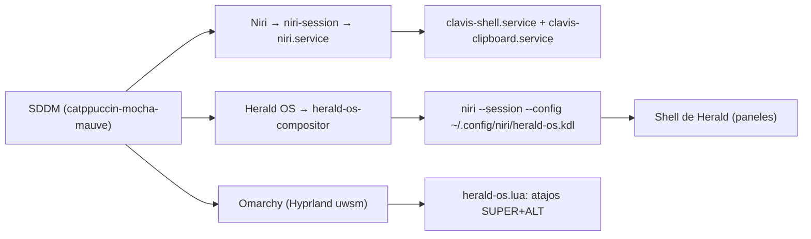

# 🛰️ Sesión Herald OS en SDDM

> [!NOTE]
> **Hoja de Ruta:**
> * Anterior: [[01.3 - Paso 3 - Clavis Shell y Actualizaciones|Paso 3: Clavis Shell y Actualizaciones]]
> **👉 01.4 (Este Playbook):** Cómo SDDM reconoce la sesión de Herald OS y cómo convive con Niri + Clavis y con Omarchy.
> * Siguiente fase: [[02.1 - MacTahoe Iconos, Cursor y Wallpapers|Personalización y Apariencia]]
> * Volver a: [[00 - Indice General (MOC)|Índice General]]

[Herald OS](https://github.com/iamlukethedev/Herald-OS) es un escritorio construido alrededor de **Hermes Agent**. Puede usarse de dos formas: como **sesión propia** elegida en SDDM (sobre `niri`) o como **aplicación dentro de Hyprland/Omarchy**.

> [!IMPORTANT]
> Este playbook **no documenta la instalación** de Herald OS. Asume que el paquete `herald-os-bin` ya está instalado y que `herald-os setup` ya se ejecutó para el usuario que va a usarlo. Solo describe cómo se integra con el entorno construido en los pasos anteriores.

---

## 🧩 Piezas en el Sistema

| Pieza | Ubicación | Rol |
|---|---|---|
| **Sesión Wayland** | `/usr/share/wayland-sessions/herald-os.desktop` | Entrada `Herald OS` en el selector de sesión de SDDM. |
| **Lanzador** | `/usr/bin/herald-os-compositor` | Script que prepara el entorno y ejecuta `niri` con la configuración de Herald. |
| **Configuración de niri** | `~/.config/niri/herald-os.kdl` (+ `theme.kdl`, `outputs.kdl`, `local.kdl`) | Generada por `herald-os keymap apply` en cada inicio. `config.kdl` nunca se lee ni se reescribe. |
| **Integración Omarchy** | `~/.config/hypr/herald-os.lua` | Atajos de Herald dentro de Hyprland, cargados desde `hyprland.lua`. |
| **Hermes Agent** | `~/.hermes` del usuario | Agente y plugin `herald-os-bridge`; existe solo para los usuarios donde se ejecutó `herald-os setup`. |
| **Registro** | `~/.local/state/herald-os/compositor.log` | Salida del compositor; primer lugar a revisar si la sesión no arranca. |

---

## 🖥️ Cómo la Reconoce SDDM

SDDM busca sesiones en `/usr/local/share/wayland-sessions` y `/usr/share/wayland-sessions`. Como `herald-os.desktop` vive en el segundo, aparece automáticamente en el selector del tema **Catppuccin Mocha** configurado en [[01.2 - Paso 2 - Creacion de Usuario y Login SDDM|Paso 2]]; no requiere `greetd` ni configuración adicional.



> [!WARNING]
> **La sesión depende de `niri`.** El lanzador usa el `niri` instalado en [[01.1 - Paso 1 - Instalacion de niri-edge y key-cli|Paso 1]] (`niri-edge`). Si `niri` falta o `herald-os keymap apply` falla, intenta arrancar con `cage`, que no forma parte de este entorno: la sesión se cerraría y SDDM volvería a la pantalla de inicio.

---

## 🤝 Convivencia con Clavis Shell

- **Sin doble shell:** `herald-os-compositor` ejecuta `niri --session` directamente, no a través de `niri.service`. Como `clavis-shell.service` y `clavis-clipboard.service` cuelgan de `WantedBy=niri.service`, **no se activan** dentro de la sesión de Herald.
- **Configuración de niri separada:** Herald usa su propio `herald-os.kdl`. Los fragmentos de Clavis (`~/.config/niri/clavis/`) y el `config.kdl` del usuario no se modifican. **El resto del tema sí** (ver la advertencia de abajo).
- **Portapapeles:** si se ejecuta `key clipboard --daemon` dentro de la sesión de Herald, no puede arrancar el servicio (no hay `niri.service`) y lanza su propio watcher (ver [[01.1 - Paso 1 - Instalacion de niri-edge y key-cli|Paso 1, sección 3]]).
- **`outputs.kdl` compartido:** Herald crea `~/.config/niri/outputs.kdl` si falta y su panel Display lo reescribe; `config.kdl` de [robert-flo/niri-dotfiles](https://github.com/robert-flo/niri-dotfiles) incluye el mismo archivo con `include optional=true`. En un usuario que use ambas sesiones, la disposición de pantallas es una sola. `local.kdl` es solo de Herald y nunca se sobrescribe.

> [!CAUTION]
> **No iniciar la sesión Herald OS con `niri` ni `sura`.** Al arrancar, `herald-os-theme` aplica su tema al usuario y pisa archivos versionados en los dotfiles (comprobado en `sura` el 2026-10-12):
> - Reemplaza el symlink `~/.config/gtk-4.0/gtk.css` por un archivo propio y crea `~/.config/gtk-3.0/gtk.css`.
> - `gsettings`: `gtk-theme 'Adwaita-dark'` y `color-scheme 'prefer-dark'` (Niri + Clavis queda oscuro y sin MacTahoe).
> - Escribe `~/.config/foot/foot.ini`, `~/.config/swaylock/config`, el perfil de `fcitx5`, `~/.config/herald-os/` y `~/.config/Herald OS/`.
>
> Herald OS se usa solo con `gracie` (el usuario con Hermes). Si ya pasó, se guarda lo que escribió Herald y se restaura desde el repo:
> ```bash
> b=~/.local/share/herald-os-overwrites-$(date +%F); mkdir -p "$b"
> mv ~/.config/gtk-3.0/gtk.css "$b"/ 2>/dev/null
> dotbare status -s                  # ver qué archivos versionados cambió
> dotbare checkout -- .config/gtk-4.0/gtk.css   # y cualquier otro que aparezca
> ~/.local/bin/niri-dotfiles-postinstall        # restaura gsettings
> ```

> [!NOTE]
> **No existe un usuario `herald-os`.** En SDDM se elige el usuario (`gracie`) con **su propia contraseña** y, en el selector de sesión, `Herald OS`. SDDM recuerda la última sesión de cada usuario.

> [!TIP]
> **Por usuario:** la sesión tiene sentido para los usuarios que tienen Hermes configurado. En un usuario sin `~/.hermes` la sesión puede iniciar, pero los paneles de Hermes no tendrán agente.

---

## ⌨️ Atajos dentro de Hyprland / Omarchy

`~/.config/hypr/herald-os.lua` define (y `hyprland.lua` lo carga con `require("hypr.herald-os")`):

| Atajo | Acción |
|---|---|
| `SUPER + ALT + H` | Abrir Herald OS |
| `SUPER + ALT + A` | Preguntar a Hermes sobre la ventana actual |
| `SUPER + ALT + C` | Barra de comandos de Hermes |
| `SUPER + ALT + V` | Hablar con Hermes |
| `SUPER + ALT + X` | Dictar en la aplicación enfocada |
| `SUPER + ALT + E` | Emojis |
| `SUPER + ALT + M` | Misiones de Hermes |

Ninguno choca con los atajos de Omarchy. Estos atajos solo existen en Hyprland: en la sesión Niri + Clavis, `Mod+Alt+V` sigue siendo el atajo de Clavis (ver [[05.1 - Mapa Completo de Atajos de Teclado (Niri y Clavis)|Mapa de Atajos]]) y no hay conflicto porque cada compositor carga solo sus propios atajos.

---

## 📦 Dependencias Opcionales de la Sesión

Las funciones de la sesión que dependen de paquetes no instalados por este playbook simplemente no aparecen:

| Paquete | Función en Herald OS |
|---|---|
| `swayidle` | Bloqueo y apagado de pantalla por inactividad |
| `wlsunset` | Luz nocturna |
| `wf-recorder` | Grabación de pantalla |
| `podman` | Máquina virtual de Windows y contenedores |
| `greetd` | Pantalla de inicio alternativa (innecesaria: se usa SDDM) |

---

## 🔍 Verificación

```bash
# 1. SDDM lee el directorio donde vive la sesión
sddm --example-config | grep '^SessionDir'
ls -l /usr/share/wayland-sessions/herald-os.desktop

# 2. La configuración de niri de Herald se genera y es válida
herald-os keymap apply
t=$(mktemp -d); cp ~/.config/niri/herald-os.kdl "$t"/
for f in theme outputs local; do echo "// stub" > "$t/$f.kdl"; done
niri validate -c "$t/herald-os.kdl"; rm -rf "$t"
# Salida esperada: INFO niri: config is valid

# 3. Integración con Omarchy
herald-os omarchy status
hyprctl configerrors   # vacío

# 4. Tras iniciar la sesión desde SDDM, si algo falla
tail -50 ~/.local/state/herald-os/compositor.log
```

---

## 🔗 Referencias Relacionadas

- [[01.2 - Paso 2 - Creacion de Usuario y Login SDDM|Paso 2: Usuario y Login SDDM]]
- [[01.3 - Paso 3 - Clavis Shell y Actualizaciones|Paso 3: Clavis Shell y Actualizaciones]]
- [[05.2 - Repositorios Upstream y Fuentes Externas|Repositorios Upstream y Fuentes Externas]]
