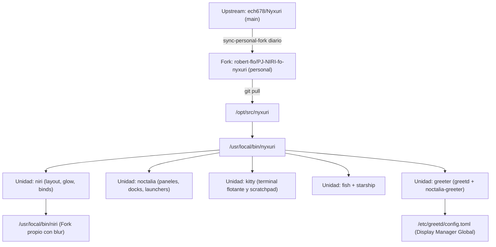

# ❄️ Entorno Modular Nyxuri: Niri y Noctalia Shell

> [!NOTE]
> **Navegación:**
> * Anterior: [[02.4 - Referencias de Temas, Wallpapers y Recursos|Referencias de Temas y Recursos]]
> * Siguiente: [[02.6 - Configuracion Dual de Neovim (Craftzdog y rvim)|Configuración Dual de Neovim (Craftzdog y rvim)]]
> * Volver a: [[00 - Indice General (MOC)|Índice General]]

Esta guía detalla la instalación, configuración y mantenimiento de **Nyxuri** (anteriormente conocido como NyxNiri): un sistema modular de escritorio para Wayland centrado en el compositor **Niri** y la shell **Noctalia**, complementado por **Greetd** y el **Noctalia Greeter**.

Este componente está diseñado con una arquitectura **completamente desacoplada** del escritorio principal Clavis: vive en sus propios usuarios (`nyxuri` y `nyxuri-test`), se mantiene mediante su propio script de actualización (`update-nyxuri-desktop.sh`), y puede instalarse o removerse en su totalidad sin alterar la configuración de Clavis o de Omarchy.

---

## 🏛️ Arquitectura del Entorno Nyxuri



### Tabla de Componentes y Fuentes

| Componente | Repositorio Propio (`origin`, rama `personal`) | Upstream Oficial | Rol en el Sistema |
|---|---|---|---|
| **Nyxuri Engine** | [robert-flo/PJ-NIRI-fo-nyxuri](https://github.com/robert-flo/PJ-NIRI-fo-nyxuri) | [ech678/Nyxuri](https://github.com/ech678/Nyxuri) | Motor modular de unidades, presets y despliegue de configuraciones. |
| **Niri Compositor** | [robert-flo/PJ-NIRI-fo-niri-edge](https://github.com/robert-flo/PJ-NIRI-fo-niri-edge) | [StatIndet/niri-edge](https://github.com/StatIndet/niri-edge) | Compositor Wayland ejecutado en `/usr/local/bin/niri`. |
| **Noctalia Shell** | `extra/noctalia` | Repositorio Oficial Arch | Shell visual Wayland con Orbit Launcher, sincronización Material You y centro de control. |
| **Noctalia Greeter** | `extra/noctalia-greeter` | Repositorio Oficial Arch | Pantalla de inicio de sesión visual impulsada por `greetd`. |

---

## 🛠️ Instalación y Configuración Paso a Paso

### Paso 1: Instalación de Paquetes del Sistema

Todos los paquetes principales y aplicaciones complementarias se encuentran en los repositorios oficiales de Arch Linux (`extra`):

```bash
sudo pacman -S --needed --noconfirm \
    noctalia greetd noctalia-greeter kitty starship wlsunset \
    python-gobject gtk-layer-shell wl-clipboard python-cairo \
    xdg-desktop-portal-gnome fastfetch zed mission-center
```

---

### Paso 2: Despliegue de Fuentes y Launchers Globales

El repositorio se clona en `/opt/src/nyxuri` bajo la rama `personal`. Se garantiza acceso multiusuario mediante la regla de Git `safe.directory`:

```bash
BUILD_DIR="${BUILD_DIR:-/opt/src}"
sudo mkdir -p "$BUILD_DIR" && sudo chown -R "$USER:$USER" "$BUILD_DIR"

if [ ! -d "$BUILD_DIR/nyxuri" ]; then
    git clone -b personal https://github.com/robert-flo/PJ-NIRI-fo-nyxuri.git "$BUILD_DIR/nyxuri"
    git -C "$BUILD_DIR/nyxuri" remote add upstream https://github.com/ech678/Nyxuri.git
    git -C "$BUILD_DIR/nyxuri" remote set-url --push upstream DISABLE
else
    cd "$BUILD_DIR/nyxuri" && git fetch origin && git checkout personal && git pull --ff-only
fi

# 1. Enlaces simbólicos de los launchers globales
sudo ln -sf "$BUILD_DIR/nyxuri/nyxuri/launcher.sh" /usr/local/bin/nyxuri
sudo chmod +x "$BUILD_DIR/nyxuri/nyxuri/launcher.sh"

sudo ln -sf "$BUILD_DIR/nyxuri/shell/nyxuri-shell" /usr/local/bin/nyxuri-shell
sudo chmod +x "$BUILD_DIR/nyxuri/shell/nyxuri-shell"

# 2. Configurar safe.directory a nivel de sistema para evitar errores de propiedad cruzada
sudo git config --system --add safe.directory '/opt/src/*'
```

---

### Paso 3: Configuración de Unidades y Shell Experimental en los Usuarios

Ejecutar la activación de las unidades base, el editor Zed y la suite modular completa de Nyxuri Shell para las cuentas dedicadas `nyxuri` (producción) y `nyxuri-test` (pruebas):

```bash
BASE_UNITS="niri noctalia kitty fastfetch fish starship theme wallpapers xdg-desktop-portal zed"
SHELL_UNITS="shell.bar shell.desktopcards shell.dock shell.keystone shell.launcher shell.lock shell.notifications shell.regionselector shell.session shell.settings shell.sidebars shell.wallpaper"

for u in nyxuri nyxuri-test; do
    echo "==> Activando unidades de Nyxuri para $u..."
    for unit in $BASE_UNITS $SHELL_UNITS; do
        sudo -u "$u" -H nyxuri on "$unit"
    done
    
    # Fijar Nyxuri Shell experimental en el ledger
    sudo -u "$u" -H nyxuri shell set nyxuri-shell /usr/local/bin/nyxuri-shell
    
    # Renderizar plantillas dinámicas (GTK CSS, Niri glow, rutas dinámicas)
    sudo -u "$u" -H python3 -c "import sys; sys.path.insert(0, '$BUILD_DIR/nyxuri'); from nyxuri.deploy.templates import _phase_render_templates; _phase_render_templates()"
done
```

---

### Paso 4: Activación de Greetd y Noctalia Greeter

Para activar el gestor de inicio gráfico **Greetd** junto con **Noctalia Greeter**, el hook de Nyxuri realiza la transición limpia respaldando el estado anterior del display manager:

```bash
sudo -u nyxuri -H nyxuri on greeter
```

Esto generará automáticamente:
1. `/etc/greetd/config.toml` (configurado para lanzar `noctalia-greeter-session -- --session niri`).
2. `/etc/polkit-1/rules.d/50-noctalia-greeter.rules` (sincronización de temas desde la sesión de usuario).
3. Desactivación de `sddm.service` y activación de `greetd.service`.

> [!TIP]
> Copias de respaldo de estos archivos de sistema se encuentran preservadas en `assets/system/etc/greetd/` y `assets/system/etc/polkit-1/rules.d/`.

---

### Paso 5: Colección Extendida de Wallpapers y Espejo Compartido

Para tener disponibles todos los fondos y videos animados de `mpvpaper` tanto en los usuarios como en el almacenamiento compartido del sistema:

```bash
# 1. Clonar espejo compartido en /z
sudo git clone --depth 1 https://github.com/ech678/wallpaper-collection.git /z/wallpaper-collection
sudo chown -R "$USER:wheel" /z/wallpaper-collection
sudo chmod -R 775 /z/wallpaper-collection

# 2. Desplegar en los usuarios nyxuri y nyxuri-test
sudo -u nyxuri -H bash -c 'cd /home/nyxuri && bash /opt/src/nyxuri/units/wallpapers/hooks/install-pack'
sudo -u nyxuri-test -H bash -c 'cd /home/nyxuri-test && bash /opt/src/nyxuri/units/wallpapers/hooks/install-pack'
```

---

## 🔍 Verificación y Diagnóstico

Para auditar el estado del entorno en cualquier momento:

```bash
sudo -u nyxuri -H nyxuri doctor
```

El diagnóstico auditará:
* Estado de las 10 unidades activas (reporte `Synced`).
* Disponibilidad del binario Niri (`/usr/local/bin/niri`).
* Integración de `wlsunset` (control de luz nocturna / Eye Care).
* Estado de `greetd.service` y `noctalia-greeter`.

---

## 🔄 Mantenimiento y Actualizaciones Automáticas

Para mantener Nyxuri actualizado sin tocar los scripts de Clavis, se implementa el script independiente `/usr/local/bin/update-nyxuri-desktop.sh` (copia exacta en `assets/system/usr/local/bin/update-nyxuri-desktop.sh`):

### Ejecución Manual:
```bash
sudo update-nyxuri-desktop.sh
```

### Operaciones del Script:
1. Avanza `/opt/src/nyxuri` sobre `origin/personal` y refresca los launchers `/usr/local/bin/nyxuri` y `/usr/local/bin/nyxuri-shell`.
2. Sincroniza todas las unidades base y modulares de `shell.*` en los usuarios `nyxuri` y `nyxuri-test`.
3. Fija `nyxuri-shell` como entorno activo en el ledger y renderiza plantillas dinámicas (wallpapers, CSS, atajos).
4. Actualiza paquetes del sistema mediante `pacman -Syu`.

---

## 📋 Inventario y Repositorio de Opciones y Pendientes

Nyxuri sigue una arquitectura estricta donde **«todo componente es una unidad»** con ciclo de vida atómico. A continuación se detalla la matriz de estado entre lo que está configurado en producción frente a los componentes opcionales y pendientes disponibles:

### Matriz de Estado de Componentes

| Componente / Unidad | Tipo | Estado en el Sistema | Descripción y Acciones |
|---|---|---|---|
| `greeter` | Opcional en Upstream | **Configurado y Activo** | Greetd + Noctalia Greeter reemplazando globalmente a SDDM. |
| `niri` | Núcleo | **Configurado y Activo** | Niri compilado desde fork con presets, layout, glow y binds. |
| `noctalia` | Núcleo | **Configurado y Activo** | Shell Noctalia con Orbit Launcher, Material You y widgets. |
| `fish` + `starship` | Núcleo | **Configurado y Activo** | Shell interactiva con plugins Fisher (autopair, fzf) y prompt Starship. |
| `kitty` | Núcleo | **Configurado y Activo** | Terminal con esquemas dinámicos (`noctalia.conf` / `nyxuri.conf`). |
| `theme` | Núcleo | **Configurado y Activo** | Plantillas GTK3, GTK4, Niri glow y paleta Material You sincronizada. |
| `wallpapers` (Base) | Opcional en Upstream | **Configurado y Activo** | Imagen estática fallback (`lawson_fuji.webp`) en `~/Pictures/Wallpapers`. |
| `wallpapers` (Pack Extendido) | Extra Opcional | **Instalado y Activo** | Colección extendida con videos animados desplegada en `nyxuri` y `nyxuri-test`, respaldada en `/z/wallpaper-collection`. |
| `zed` | Unidad Opcional | **Instalado y Activo** | Editor de código Zed instalado vía pacman; unidad `zed` habilitada con atajos y ajustes en ambos usuarios. |
| `mission-center` | App de Catálogo | **Instalado y Activo** | Monitor del sistema gráfico y moderno (CPU, GPU, RAM, red) integrado desde `catalog.toml`. |
| `fcitx5-rime` | Unidad Opcional | **Opcional no requerido** | Motor de entrada multilingüe (Chino/Rime) con tema NyxMellow. Solo relevante para usuarios de escritura CJK. |
| `mango` | Unidad Opcional | **Opcional no requerido** | Soporte para el compositor alternativo Mango WM. Deshabilitado ya que el entorno estándar es Niri. |
| `nyxuri-shell` (`shell.*`) | Shell Experimental | **Activo (Experimental)** | Suite nativa en Quickshell/Qt 6 modular. Fijada como shell activa en el ledger y binario `/usr/local/bin/nyxuri-shell` enlazado; las 12 unidades modulares (`shell.bar`, `shell.dock`, `shell.launcher`, etc.) están activadas. |

---

### Instrucciones para Activar o Probar Componentes Opcionales

#### 1. Paquete Extendido de Wallpapers (Animados e Imágenes)
La colección extendida con videos animados para `mpvpaper` se encuentra instalada en `~/Pictures/Wallpapers` para `nyxuri` y `nyxuri-test`, y respaldada en el almacenamiento compartido `/z/wallpaper-collection`.

Para volver a sincronizar o descargar manualmente:
```bash
# Ejecutar el hook desde el directorio personal del usuario
sudo -u nyxuri -H bash -c 'cd /home/nyxuri && bash /opt/src/nyxuri/units/wallpapers/hooks/install-pack'
sudo -u nyxuri-test -H bash -c 'cd /home/nyxuri-test && bash /opt/src/nyxuri/units/wallpapers/hooks/install-pack'
```

#### 2. Editor Zed con Perfil Nyxuri
El editor Zed se encuentra instalado en el sistema (`extra/zed`) y su unidad configurada en `~/.config/zed` para `nyxuri` y `nyxuri-test`.
```bash
# Lanzar Zed desde terminal o selector
zed &

# Reaplicar configuraciones de la unidad
sudo -u nyxuri -H nyxuri on zed
```

#### 3. Nyxuri Shell Nativa Quickshell (Modo Experimental)
Para seguir la rama experimental de Nyxuri Shell sobre el commit más reciente:
- Binario wrapper global: `/usr/local/bin/nyxuri-shell` -> `/opt/src/nyxuri/shell/nyxuri-shell`.
- Motor: Quickshell (`/usr/bin/qs`).
- Unidades activadas: `shell.bar`, `shell.desktopcards`, `shell.dock`, `shell.keystone`, `shell.launcher`, `shell.lock`, `shell.notifications`, `shell.regionselector`, `shell.session`, `shell.settings`, `shell.sidebars`, `shell.wallpaper`.

Comandos de gestión de la shell:
```bash
# Ver estado actual de la shell
sudo -u nyxuri -H nyxuri shell status

# Conmutar entre Noctalia y Nyxuri Shell
sudo -u nyxuri -H nyxuri shell set nyxuri-shell /usr/local/bin/nyxuri-shell
sudo -u nyxuri -H nyxuri shell set noctalia

# Despachar acciones interactivas directas en Wayland
nyxuri-shell --action launcher
nyxuri-shell --action settings
nyxuri-shell --action session
```

#### 4. Ajuste de Presets de Efectos y Glow en Niri
Nyxuri incluye presets intercambiables en caliente para Niri:
```bash
# Ver presets y partes de Niri
sudo -u nyxuri -H nyxuri preset niri parts

# Alternar modo descanso visual (EyeCare) con wlsunset
~/.config/niri/scripts/toggle-eyecare.sh
```

#### 5. Aplicaciones Recomendadas del Catálogo (`catalog.toml`)
Nyxuri incluye un catálogo de aplicaciones probadas y optimizadas instaladas en el sistema:
- `mission-center`: Monitor gráfico de CPU/GPU/RAM/Red.
- `nautilus`: Gestor de archivos visual.
- `obs-studio`: Grabación y transmisión Wayland.
```bash
# Lanzar monitor del sistema
mission-center &
```

---

## 🗑️ Procedimiento de Desinstalación Limpia (Rollback Total)

Si en el futuro decides remover Nyxuri sin dejar rastro en el sistema:

### 1. Revertir Display Manager a SDDM
```bash
# Apagar la unidad greeter en Nyxuri (restaura SDDM automáticamente)
sudo -u nyxuri -H nyxuri off greeter

# O manualmente:
sudo systemctl disable greetd.service
sudo systemctl enable sddm.service
```

### 2. Remover Unidades y Configuración de Usuario
```bash
sudo -u nyxuri -H nyxuri uninstall --all
sudo -u nyxuri-test -H nyxuri uninstall --all
```

### 3. Eliminar Usuarios y Privilegios
```bash
sudo userdel -r nyxuri 2>/dev/null || true
sudo userdel -r nyxuri-test 2>/dev/null || true
sudo rm -f /etc/sudoers.d/04_nyxuri /etc/sudoers.d/04_nyxuri-test
```

### 4. Eliminar Archivos de Sistema y Fuentes
```bash
sudo rm -rf /opt/src/nyxuri /usr/local/bin/nyxuri /usr/local/bin/nyxuri-shell /usr/local/bin/update-nyxuri-desktop.sh /z/wallpaper-collection
sudo rm -rf /etc/greetd /var/lib/noctalia-greeter /etc/polkit-1/rules.d/50-noctalia-greeter.rules
```
El sistema quedará exactamente en su estado previo con Clavis y SDDM sin archivos residuales.
