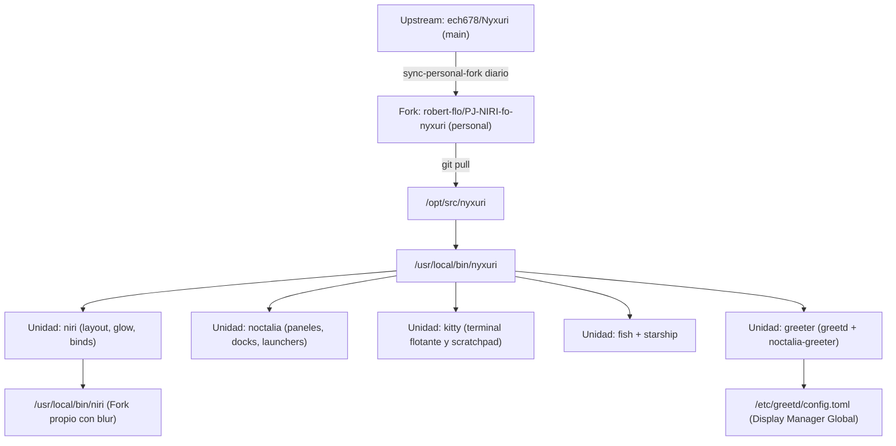

# ❄️ Entorno Modular Nyxuri: Niri y Noctalia Shell

> [!NOTE]
> **Navegación:**
> * Anterior: [[02.4 - Referencias de Temas, Wallpapers y Recursos|Referencias de Temas y Recursos]]
> * Siguiente: [[03.1 - Dotfiles con dotbare|Gestión de Dotfiles con dotbare]]
> * Volver a: [[00 - Indice General (MOC)|Índice General]]

Esta guía detalla la instalación, configuración y mantenimiento de **Nyxuri** (anteriormente conocido como NyxNiri): un sistema modular de escritorio para Wayland centrado en el compositor **Niri** y la shell **Noctalia**, complementado por **Greetd** y el **Noctalia Greeter**.

Este componente está diseñado con una arquitectura **completamente desacoplada** del escritorio principal Clavis: vive en sus propios usuarios (`nyxuri` y `nyxuri-test`), se mantiene mediante su propio script de actualización (`update-nyxuri-desktop.sh`), y puede instalarse o removerse en su totalidad sin alterar la configuración de Clavis o de Omarchy.

---

## 🏛️ Arquitectura del Entorno Nyxuri



### Tabla de Componentes y Fuentes

| Componente | Repositorio Propio (`origin`, rama `personal`) | Upstream Oficial | Rol en el Sistema |
|---|---|---|---|
| **Nyxuri Engine** | [robert-flo/PJ-NIRI-fo-nyxuri](https://github.com/robert-flo/PJ-NIRI-fo-nyxuri) | [ech678/Nyxuri](https://github.com/ech678/Nyxuri) | Motor modular de unidades, presets y despliegue de configuraciones. |
| **Niri Compositor** | [robert-flo/PJ-NIRI-fo-niri-edge](https://github.com/robert-flo/PJ-NIRI-fo-niri-edge) | [StatIndet/niri-edge](https://github.com/StatIndet/niri-edge) | Compositor Wayland ejecutado en `/usr/local/bin/niri`. |
| **Noctalia Shell** | `extra/noctalia` | Repositorio Oficial Arch | Shell visual Wayland con Orbit Launcher, sincronización Material You y centro de control. |
| **Noctalia Greeter** | `extra/noctalia-greeter` | Repositorio Oficial Arch | Pantalla de inicio de sesión visual impulsada por `greetd`. |

---

## 🛠️ Instalación y Configuración Paso a Paso

### Paso 1: Instalación de Paquetes del Sistema

Todos los paquetes principales se encuentran en los repositorios oficiales de Arch Linux (`extra`):

```bash
sudo pacman -S --needed --noconfirm \
    noctalia greetd noctalia-greeter kitty starship wlsunset \
    python-gobject gtk-layer-shell wl-clipboard python-cairo \
    xdg-desktop-portal-gnome fastfetch
```

---

### Paso 2: Despliegue de Fuentes y Launcher Global

El repositorio se clona en `/opt/src/nyxuri` bajo la rama `personal`. Se garantiza acceso multiusuario mediante la regla de Git `safe.directory`:

```bash
BUILD_DIR="${BUILD_DIR:-/opt/src}"
sudo mkdir -p "$BUILD_DIR" && sudo chown -R "$USER:$USER" "$BUILD_DIR"

if [ ! -d "$BUILD_DIR/nyxuri" ]; then
    git clone -b personal https://github.com/robert-flo/PJ-NIRI-fo-nyxuri.git "$BUILD_DIR/nyxuri"
    git -C "$BUILD_DIR/nyxuri" remote add upstream https://github.com/ech678/Nyxuri.git
    git -C "$BUILD_DIR/nyxuri" remote set-url --push upstream DISABLE
else
    cd "$BUILD_DIR/nyxuri" && git fetch origin && git checkout personal && git pull --ff-only
fi

# 1. Enlace simbólico del launcher global
sudo ln -sf "$BUILD_DIR/nyxuri/nyxuri/launcher.sh" /usr/local/bin/nyxuri
sudo chmod +x "$BUILD_DIR/nyxuri/nyxuri/launcher.sh"

# 2. Configurar safe.directory a nivel de sistema para evitar errores de propiedad cruzada
sudo git config --system --add safe.directory '/opt/src/*'
```

---

### Paso 3: Configuración de Unidades en los Usuarios

Ejecutar la activación de las unidades de Nyxuri para las cuentas dedicadas `nyxuri` (producción) y `nyxuri-test` (pruebas):

```bash
UNITS="niri noctalia kitty fastfetch fish starship theme wallpapers xdg-desktop-portal"

for u in nyxuri nyxuri-test; do
    echo "==> Activando unidades de Nyxuri para $u..."
    for unit in $UNITS; do
        sudo -u "$u" -H nyxuri on "$unit"
    done
done
```

---

### Paso 4: Activación de Greetd y Noctalia Greeter

Para activar el gestor de inicio gráfico **Greetd** junto con **Noctalia Greeter**, el hook de Nyxuri realiza la transición limpia respaldando el estado anterior del display manager:

```bash
sudo -u nyxuri -H nyxuri on greeter
```

Esto generará automáticamente:
1. `/etc/greetd/config.toml` (configurado para lanzar `noctalia-greeter-session -- --session niri`).
2. `/etc/polkit-1/rules.d/50-noctalia-greeter.rules` (sincronización de temas desde la sesión de usuario).
3. Desactivación de `sddm.service` y activación de `greetd.service`.

> [!TIP]
> Copias de respaldo de estos archivos de sistema se encuentran preservadas en `assets/system/etc/greetd/` y `assets/system/etc/polkit-1/rules.d/`.

---

## 🔍 Verificación y Diagnóstico

Para auditar el estado del entorno en cualquier momento:

```bash
sudo -u nyxuri -H nyxuri doctor
```

El diagnóstico auditará:
* Estado de las 10 unidades activas (reporte `Synced`).
* Disponibilidad del binario Niri (`/usr/local/bin/niri`).
* Integración de `wlsunset` (control de luz nocturna / Eye Care).
* Estado de `greetd.service` y `noctalia-greeter`.

---

## 🔄 Mantenimiento y Actualizaciones Automáticas

Para mantener Nyxuri actualizado sin tocar los scripts de Clavis, se implementa el script independiente `/usr/local/bin/update-nyxuri-desktop.sh` (copia exacta en `assets/system/usr/local/bin/update-nyxuri-desktop.sh`):

### Ejecución Manual:
```bash
sudo update-nyxuri-desktop.sh
```

### Operaciones del Script:
1. Avanza `/opt/src/nyxuri` sobre `origin/personal` mediante `git merge --ff-only '@{u}'`.
2. Sincroniza las unidades actualizadas en los usuarios `nyxuri` y `nyxuri-test`.
3. Actualiza paquetes del sistema mediante `pacman -Syu`.

---

## 🗑️ Procedimiento de Desinstalación Limpia (Rollback Total)

Si en el futuro decides remover Nyxuri sin dejar rastro en el sistema:

### 1. Revertir Display Manager a SDDM
```bash
# Apagar la unidad greeter en Nyxuri (restaura SDDM automáticamente)
sudo -u nyxuri -H nyxuri off greeter

# O manualmente:
sudo systemctl disable greetd.service
sudo systemctl enable sddm.service
```

### 2. Remover Unidades y Configuración de Usuario
```bash
sudo -u nyxuri -H nyxuri uninstall --all
sudo -u nyxuri-test -H nyxuri uninstall --all
```

### 3. Eliminar Usuarios y Privilegios
```bash
sudo userdel -r nyxuri 2>/dev/null || true
sudo userdel -r nyxuri-test 2>/dev/null || true
sudo rm -f /etc/sudoers.d/04_nyxuri /etc/sudoers.d/04_nyxuri-test
```

### 4. Eliminar Archivos de Sistema y Fuentes
```bash
sudo rm -rf /opt/src/nyxuri /usr/local/bin/nyxuri /usr/local/bin/update-nyxuri-desktop.sh
sudo rm -rf /etc/greetd /var/lib/noctalia-greeter /etc/polkit-1/rules.d/50-noctalia-greeter.rules
```
El sistema quedará exactamente en su estado previo con Clavis y SDDM sin archivos residuales.
