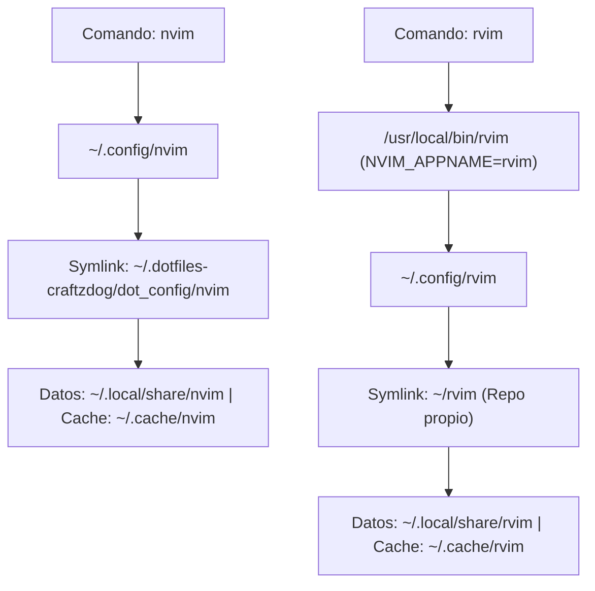

# 🚀 Configuración Dual de Neovim (`nvim` + `rvim`)

> [!NOTE]
> **Navegación:**
> * Anterior: [[02.5 - Entorno Modular Nyxuri (Noctalia Shell)|Entorno Modular Nyxuri (Noctalia Shell)]]
> * Siguiente: [[03.1 - Dotfiles con dotbare|Gestión de Dotfiles con dotbare]]
> * Volver a: [[00 - Indice General (MOC)|Índice General]]

Este módulo documenta el despliegue de un entorno de edición dual basado en **Neovim >= 0.12**, garantizando que todos los usuarios del sistema (`omarchy`, `niri`, `sura`, `nyxuri`, `nyxuri-test`) dispongan de dos entornos totalmente aislados, funcionales y sin colisión:

1. **Configuración Principal (`nvim`)**: Portada desde el fork [`robert-flo/dotfiles-craftzdog`](https://github.com/robert-flo/dotfiles-craftzdog), rama **`feat/late-2026`**, empleando el gestor de paquetes nativo de Neovim (`vim.pack`), tema Solarized Osaka, Snacks UI y mini.icons.
2. **Configuración Secundaria Aislada (`rvim`)**: Distro propia mantenida en [`robert-flo/rvim`](https://github.com/robert-flo/rvim), invocable globalmente mediante el comando de terminal `rvim` gracias a la funcionalidad nativa de aislamiento `NVIM_APPNAME="rvim"`.

---

## 🏛️ Arquitectura Dual de Neovim



---

## 📋 Prerrequisitos del Sistema

* **Neovim** $\ge$ **0.12** (requerido para la API nativa `vim.pack`).
* **Git** y **GitHub CLI (`gh`)**.
* **Compilador C** (`gcc`) y **tree-sitter CLI** (para la compilación de parsers de sintaxis).
* **Herramientas de búsqueda**: `ripgrep` (`rg`), `fd`, `lazygit`.

Todos estos paquetes se instalan a través de los repositorios oficiales de Arch:

```bash
sudo pacman -S --needed --noconfirm \
    neovim git gcc tree-sitter-cli ripgrep fd lazygit
```

---

## 🛠️ Procedimiento de Instalación Paso a Paso

### Paso 1: Wrapper Global de Sistema (`/usr/local/bin/rvim`)

Para que el comando `rvim` esté disponible de forma global para cualquier usuario y sesión sin depender del `$PATH` local:

```bash
sudo tee /usr/local/bin/rvim << 'EOF'
#!/usr/bin/env bash
# Wrapper para invocar Neovim usando la configuración aislada 'rvim'
# Utiliza NVIM_APPNAME para separar configuración (~/.config/rvim), plugins, caché y estado.
NVIM_APPNAME="rvim" exec nvim "$@"
EOF

sudo chmod 755 /usr/local/bin/rvim
```

> [!TIP]
> Una copia exacta de este wrapper se encuentra preservada en `assets/system/usr/local/bin/rvim`.

---

### Paso 2: Despliegue en los Usuarios del Sistema

Para desplegar ambas configuraciones en las cuentas de usuario (`omarchy`, `niri`, `sura`, `nyxuri`, `nyxuri-test`), ejecutar el siguiente bucle automatizado:

```bash
TARGET_USERS=("omarchy" "niri" "nyxuri" "nyxuri-test")

for u in "${TARGET_USERS[@]}"; do
    if id "$u" &>/dev/null; then
        echo "==> Configurando Neovim dual para $u..."
        sudo -u "$u" -H bash -c '
        set -euo pipefail
        cd "$HOME"

        # 1. Limpieza de configuraciones previas (ej. LazyVim en /etc/skel)
        if [ -d "$HOME/.config/nvim" ] && [ ! -L "$HOME/.config/nvim" ]; then
            rm -rf "$HOME/.config/nvim"
        fi
        rm -rf "$HOME/.local/share/nvim" "$HOME/.local/state/nvim" "$HOME/.cache/nvim"

        # 2. Configuración Principal: Fork Craftzdog (rama feat/late-2026)
        if [ ! -d "$HOME/.dotfiles-craftzdog" ]; then
            git clone --branch feat/late-2026 --depth 1 https://github.com/robert-flo/dotfiles-craftzdog.git "$HOME/.dotfiles-craftzdog"
        else
            cd "$HOME/.dotfiles-craftzdog" && git fetch origin && git checkout feat/late-2026 && git pull --ff-only || true
            cd "$HOME"
        fi
        mkdir -p "$HOME/.config"
        ln -sfn "$HOME/.dotfiles-craftzdog/dot_config/nvim" "$HOME/.config/nvim"

        # 3. Configuración Secundaria: Distro rvim
        if [ ! -d "$HOME/rvim" ]; then
            git clone --depth 1 https://github.com/robert-flo/rvim.git "$HOME/rvim"
        else
            cd "$HOME/rvim" && git pull --ff-only || true
            cd "$HOME"
        fi
        ln -sfn "$HOME/rvim" "$HOME/.config/rvim"
        mkdir -p "$HOME/.local/bin"
        install -m 755 "$HOME/rvim/bin/rvim" "$HOME/.local/bin/rvim"

        # 4. Inicialización Headless (descarga e indexación vim.pack)
        nvim --headless "+qa" 2>/dev/null || true
        rvim --headless "+qa" 2>/dev/null || true
        '
    fi
done
```

---

## 🔍 Verificación y Pruebas de Aislamiento

Para certificar que ambas instancias operan de forma independiente y que las rutas de configuración y estado están aisladas:

```bash
# Prueba 1: Ruta de configuración de nvim (debe resolver a ~/.config/nvim)
nvim --headless -c "echo stdpath('config')" -c "qa"

# Prueba 2: Ruta de configuración de rvim (debe resolver a ~/.config/rvim)
rvim --headless -c "echo stdpath('config')" -c "qa"

# Prueba 3: Disponibilidad del comando global
which rvim
```

### Salida esperada:
```text
/home/<usuario>/.config/nvim
/home/<usuario>/.config/rvim
/usr/local/bin/rvim
```

---

## 📌 Guía de Uso Rápido

* **`nvim`**: Abre la experiencia completa de desarrollo basada en Craftzdog con soporte LSP, árboles de sintaxis Tree-sitter, explorador Snacks y tema Solarized Osaka.
* **`rvim`**: Abre tu distribución personal mínima e independiente.
* **Desarrollo y cambios en `rvim`**: Al vivir en `~/rvim`, cualquier cambio a `init.lua` o plugins puede ser gestionado con Git directamente desde ese directorio:
  ```bash
  cd ~/rvim
  git status
  git commit -am "feat: agregar nuevo atajo"
  git push origin main
  ```
