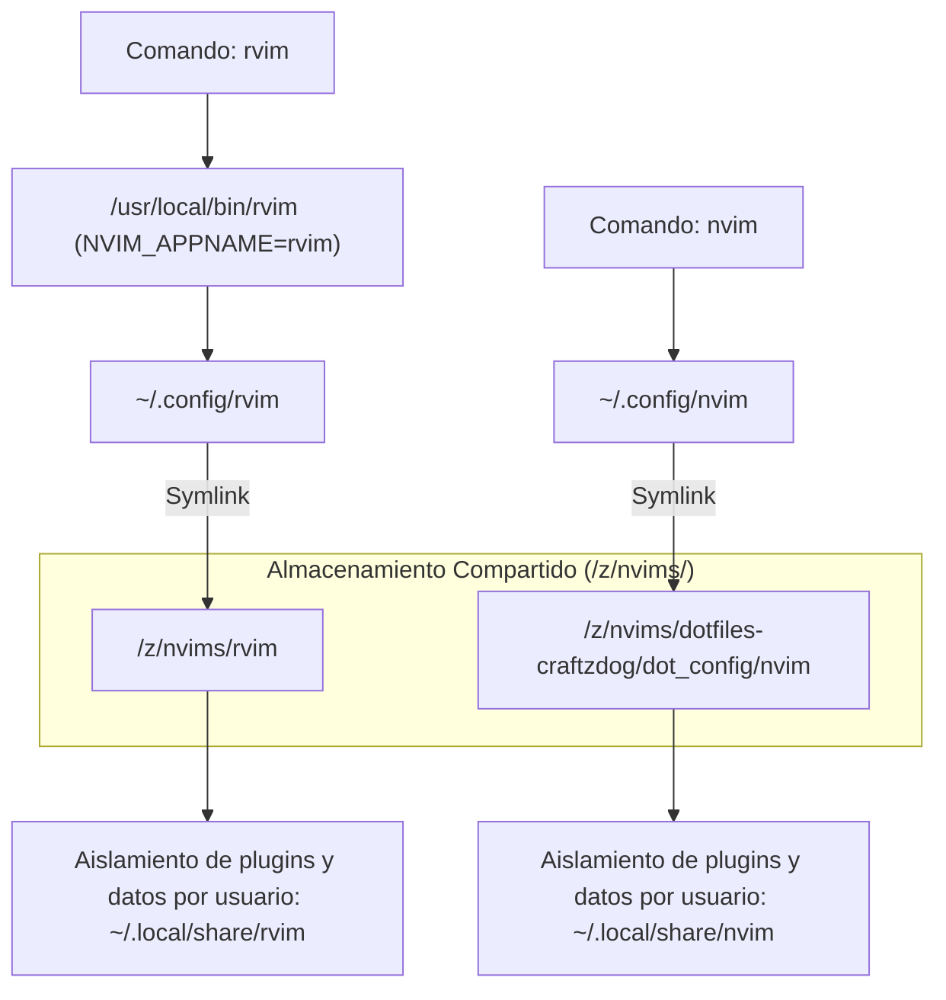

# 🚀 Configuración Dual de Neovim (`nvim` + `rvim`)

> [!NOTE]
> **Navegación:**
> * Anterior: [[02.5 - Entorno Modular Nyxuri (Noctalia Shell)|Entorno Modular Nyxuri (Noctalia Shell)]]
> * Siguiente: [[03.1 - Dotfiles con dotbare|Gestión de Dotfiles con dotbare]]
> * Volver a: [[00 - Indice General (MOC)|Índice General]]

Este módulo documenta el despliegue de un entorno de edición dual basado en **Neovim >= 0.12**, garantizando que todos los usuarios del sistema (`omarchy`, `niri`, `sura`, `nyxuri`, `nyxuri-test`) dispongan de dos entornos totalmente aislados, funcionales y sin colisión.

Siguiendo el principio de diseño de este playbook de **compartir código y evitar duplicidad en disco**, las configuraciones base no se clonan por separado en el `$HOME` de cada usuario; residen de forma centralizada en el directorio compartido **`/z/nvims/`** y se enlazan simbólicamente:

1. **Configuración Principal (`nvim`)**: Portada desde el fork [`robert-flo/dotfiles-craftzdog`](https://github.com/robert-flo/dotfiles-craftzdog), rama **`feat/late-2026`**, empleando el gestor de paquetes nativo de Neovim (`vim.pack`), tema Solarized Osaka, Snacks UI y mini.icons. Ubicada en `/z/nvims/dotfiles-craftzdog/dot_config/nvim`.
2. **Configuración Secundaria Aislada (`rvim`)**: Distro propia mantenida en [`robert-flo/rvim`](https://github.com/robert-flo/rvim), invocable globalmente mediante el comando de terminal `rvim` gracias a la funcionalidad nativa de aislamiento `NVIM_APPNAME="rvim"`. Ubicada en `/z/nvims/rvim`.

---

## 🏛️ Arquitectura Dual y Compartida de Neovim



---

## 📋 Prerrequisitos y Toolchain del Sistema

Para garantizar que Neovim funcione al 100% con todos sus plugins (snacks.nvim, nvim-treesitter, Mason, LSPs, linters, portapapeles en Wayland) y cuente con el entorno de terminal y fuentes requeridas por Craftzdog:

| Categoría | Paquetes | Propósito / Rol |
|---|---|---|
| **Editor y Control de Versiones** | `neovim`, `git`, `lazygit` | Neovim $\ge$ 0.12 (motor base con `vim.pack`), control de versiones y TUI git integrada. |
| **Compilación y Tree-sitter** | `gcc`, `clang`, `make`, `tree-sitter` | Compilación de parsers C/C++ nativos para resaltado semántico con `nvim-treesitter`. |
| **Búsqueda e Indexación** | `ripgrep`, `fd` | Backend rápido para búsqueda de archivos y live grep en Snacks picker / Telescope. |
| **Runtimes y Gestores de LSPs** | `nodejs`, `npm`, `pnpm`, `rust`, `cargo`, `python` | Ejecución de servidores de lenguaje (LSP), formateadores y linters (TypeScript, Python, Rust, etc.). |
| **Integración de Sistema** | `wl-clipboard`, `unzip`, `tar`, `curl` | Portapapeles Wayland (`wl-copy`/`wl-paste`), descarga y descompresión de binarios y tooling. |
| **Terminal y Multiplexores** | `ghostty`, `tmux`, `herdr` | Terminal GPU con soporte true color y undercurl, multiplexores y orquestador para agentes IA. |
| **Fuentes Tipográficas** | `ttf-ibmplex-mono-nerd`, `ttf-plemoljp-bin` | BlexMono Nerd Font y PlemolJP Console NF (utilizada por Craftzdog en Ghostty). |

### 1. Instalación de Paquetes Oficiales (`pacman`)

```bash
sudo pacman -S --needed --noconfirm \
    neovim git gcc clang make tree-sitter ripgrep fd lazygit \
    nodejs npm pnpm rust cargo python wl-clipboard unzip tar curl \
    ghostty tmux ttf-ibmplex-mono-nerd
```

### 2. Instalación de Paquetes desde AUR (`yay` o `paru`)

```bash
yay -S --needed --noconfirm \
    herdr-bin ttf-plemoljp-bin
```

---

## 🛠️ Procedimiento de Instalación Paso a Paso

### Paso 1: Wrapper Global de Sistema (`/usr/local/bin/rvim`)

Para que el comando `rvim` esté disponible de forma global para cualquier usuario y sesión sin depender del `$PATH` local:

```bash
sudo tee /usr/local/bin/rvim << 'EOF'
#!/usr/bin/env bash
# Wrapper para invocar Neovim usando la configuración aislada 'rvim'
# Utiliza NVIM_APPNAME para separar configuración (~/.config/rvim), plugins, caché y estado.
NVIM_APPNAME="rvim" exec nvim "$@"
EOF

sudo chmod 755 /usr/local/bin/rvim
```

> [!TIP]
> Una copia exacta de este wrapper se encuentra preservada en `assets/system/usr/local/bin/rvim`.

---

### Paso 2: Creación del Repositorio Compartido en `/z/nvims`

Se crea el directorio centralizado en `/z/nvims` con permisos grupales `wheel` (`2775` con setgid) y se configuran las reglas de seguridad de Git para acceso multiusuario:

```bash
# 1. Crear directorio compartido y permisos ACL
sudo install -d -o "$USER" -g wheel -m 2775 /z/nvims
sudo setfacl -m g:wheel:rwx -m d:g:wheel:rwx /z/nvims

# 2. Habilitar safe.directory a nivel de sistema para /z/*
sudo git config --system --add safe.directory '/z/*'

# 3. Clonar los repositorios compartidos
cd /z/nvims
git clone --branch feat/late-2026 --depth 1 https://github.com/robert-flo/dotfiles-craftzdog.git
git clone https://github.com/robert-flo/rvim.git

sudo chmod -R g+rX /z/nvims
```

---

### Paso 3: Enlace Simbólico e Inicialización en los Usuarios

Cada usuario apunta sus rutas XDG a las fuentes compartidas en `/z/nvims/`, manteniendo su caché, plugins y estado de sesión de forma aislada en su respectivo `$HOME/.local`:

```bash
TARGET_USERS=("omarchy" "niri" "nyxuri" "nyxuri-test")

for u in "${TARGET_USERS[@]}"; do
    if id "$u" &>/dev/null; then
        echo "==> Enlazando Neovim dual compartido para $u..."
        sudo -u "$u" -H bash -c '
        set -euo pipefail
        cd "$HOME"

        # 1. Limpieza de configuraciones previas no vinculadas
        if [ -d "$HOME/.config/nvim" ] && [ ! -L "$HOME/.config/nvim" ]; then
            rm -rf "$HOME/.config/nvim"
        fi
        rm -rf "$HOME/.local/share/nvim" "$HOME/.local/state/nvim" "$HOME/.cache/nvim"
        [ -d "$HOME/.dotfiles-craftzdog" ] && rm -rf "$HOME/.dotfiles-craftzdog"
        [ -d "$HOME/rvim" ] && rm -rf "$HOME/rvim"

        # 2. Enlaces simbólicos hacia /z/nvims
        mkdir -p "$HOME/.config" "$HOME/.local/bin"
        ln -sfn /z/nvims/dotfiles-craftzdog/dot_config/nvim "$HOME/.config/nvim"
        ln -sfn /z/nvims/rvim "$HOME/.config/rvim"
        ln -sfn /usr/local/bin/rvim "$HOME/.local/bin/rvim"

        # 3. Inicialización Headless (descarga e indexación vim.pack)
        nvim --headless "+qa" 2>/dev/null || true
        rvim --headless "+qa" 2>/dev/null || true
        '
    fi
done
```

---

## 🔍 Verificación y Pruebas de Aislamiento

Para certificar que ambas instancias operan de forma independiente y que las rutas de configuración y estado están aisladas:

```bash
# Prueba 1: Ruta de configuración de nvim (debe resolver a ~/.config/nvim)
nvim --headless -c "echo stdpath('config')" -c "qa"

# Prueba 2: Ruta de configuración de rvim (debe resolver a ~/.config/rvim)
rvim --headless -c "echo stdpath('config')" -c "qa"

# Prueba 3: Disponibilidad del comando global
which rvim

# Prueba 4: Disponibilidad de tipografías Nerd Font y PlemolJP
fc-match "PlemolJP Console NF"
fc-match "BlexMono Nerd Font"

# Prueba 5: Verificación de Ghostty y aceleración de terminal
ghostty --version
```

### Salida esperada:
```text
/home/<usuario>/.config/nvim
/home/<usuario>/.config/rvim
/usr/local/bin/rvim
```

---

## 📌 Guía de Uso Rápido

* **`nvim`**: Abre la experiencia completa de desarrollo basada en Craftzdog con soporte LSP, árboles de sintaxis Tree-sitter, explorador Snacks y tema Solarized Osaka.
* **`rvim`**: Abre tu distribución personal mínima e independiente.
* **Desarrollo y cambios en `rvim`**: Al residir de forma centralizada en `/z/nvims/rvim`, cualquier cambio a `init.lua` o plugins se refleja inmediatamente en todos los usuarios del sistema:
  ```bash
  cd /z/nvims/rvim
  git status
  git commit -am "feat: agregar nuevo plugin/atajo"
  git push origin main
  ```

* **Actualizaciones de Craftzdog**:
  ```bash
  cd /z/nvims/dotfiles-craftzdog
  git pull origin feat/late-2026
  ```
